<div align="center">

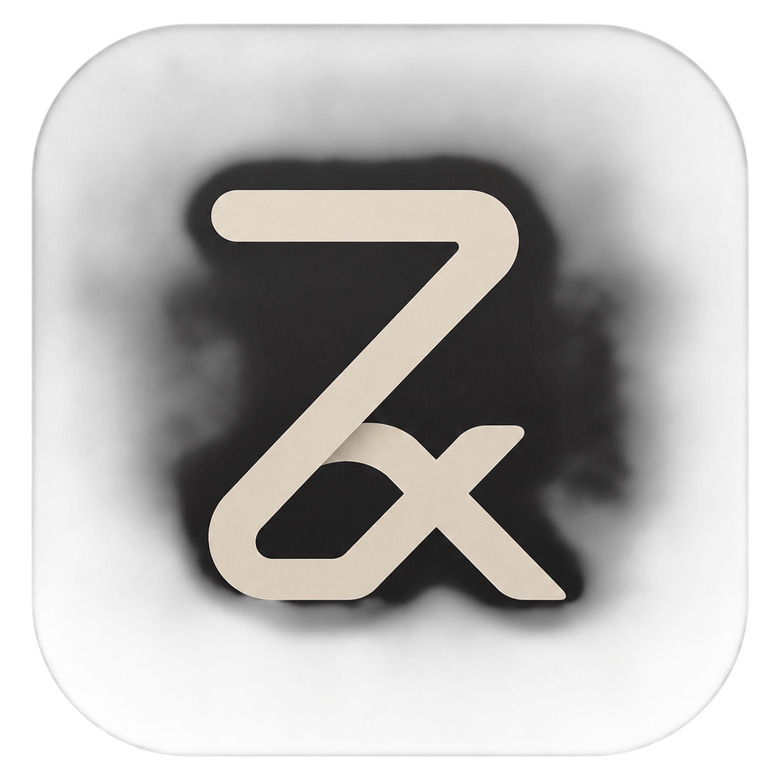

# ZYNLEX

**The minimal browser for web developers. 3.6 MB, built in Rust and Tauri, not Electron.**

ZYNLEX is a lightweight browser for local web development on Windows: the browser for `localhost`. It finds the dev servers running on your machine, and puts a network log, API response mocking, device viewports, request header rules and an API client in the sidebar. Those are the things you'd otherwise open DevTools, Postman, Charles and a responsive tester for.

[](LICENSE)
[](https://github.com/webtools-dotcom/Zynlex/actions/workflows/ci.yml)
[](https://github.com/webtools-dotcom/Zynlex/releases/latest)
[](https://github.com/webtools-dotcom/Zynlex/releases/latest)

<a href="https://webtools-dotcom.github.io/Zynlex/assets/zynlex-tour.mp4">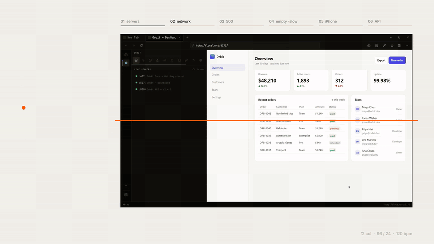</a>

<sub>[Watch the full tour in 1080p](https://webtools-dotcom.github.io/Zynlex/assets/zynlex-tour.mp4) · [Website](https://webtools-dotcom.github.io/Zynlex/)</sub>

### [Download for Windows →](https://github.com/webtools-dotcom/Zynlex/releases/latest)

3.6 MB installer · less than half Chrome's RAM at idle · no account, no telemetry · free and open source

</div>

---

## What it does

New tab shows your running dev servers. ZYNLEX scans localhost, reads the page titles, and lists them. Click one to open it.

The sidebar has the things you'd otherwise keep four apps around for:

- **Network log**: per-tab capture with filters, URL search, pause, and response bodies
- **Console**: each tab's JS errors, console warnings and failed requests, with a count on the tab itself so you notice them. F12 opens full DevTools
- **Mock responses**: fake any API response (status, body, delay) by URL pattern, or click "Mock this" on a captured request and edit it. No proxy, no certificate
- **Device viewports**: one device at a time, rendered at its real pixel size
- **Header rules**: add, override or strip request headers, matched per URL pattern
- **API client**: saved collections, cURL import, runs through Rust so page CORS doesn't apply
- **Inspector**: meta tags, Open Graph previews, and cookies including HttpOnly
- **Environments**: list a project's addresses (local, staging, production) and switch the page you're on between them in one click, same path and query. Production is marked in red and asks before you go there
- **Clear site data**: one command wipes the site's cookies, storage, IndexedDB and service workers, then reloads, for testing a first visit
- **Copy bug report**: one command puts a Markdown report of the tab on the clipboard (URL, environment, device, recent errors and failed requests) and saves a screenshot to Downloads
- **Snippets**: your own JavaScript, saved in Settings and run on the current tab from `Ctrl+K`, a shortcut or a toolbar button. Errors show in the Console
- **Network throttling**: Slow 3G, Fast 3G or offline for the current tab, from `Ctrl+K`
- **Screenshots and colours**: full-page or visible-area screenshots to Downloads, and a colour picker that copies the hex, both on the toolbar from the start
- JWT decoder, Base64, user-agent switcher

Workspaces keep each project's tabs, bookmarks, header rules and saved requests apart. `Ctrl+K` finds all of it, and every command can be given your own shortcut or pinned to the toolbar (**Settings → Shortcuts**). Out of the box the toolbar has Screenshot, Copy Bug Report and Pick Colour, the ones that work on any page with no setup.

Background tabs get out of the way on their own: after a few minutes hidden they're suspended, and later discarded, with timers you set in **Settings → Memory**. Your `localhost` tabs are never suspended, so hot reload keeps working.

No account. No telemetry. The only network call it makes on its own is an update check against this repo's GitHub releases.

## Workflows

The things you'd otherwise switch apps for, each one a command you can run from `Ctrl+K`, give a shortcut, or pin to the toolbar.

<a href="https://webtools-dotcom.github.io/Zynlex/assets/zynlex-one-key.mp4">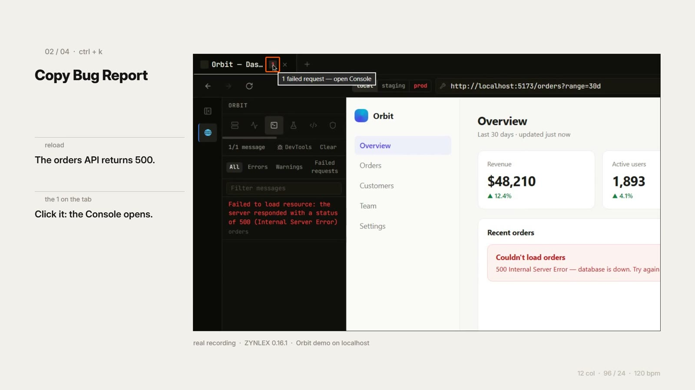</a>

<sub>[Watch the workflows film (73 s)](https://webtools-dotcom.github.io/Zynlex/assets/zynlex-one-key.mp4)</sub>

**The same page on local, staging and production.** Add a project's addresses in **Settings → Environments**. While you're on one of them, the toolbar lists them all; one click opens the same path and query on another (`Alt+Shift+1`–`4` from the keyboard). Production turns the toolbar's edge red and asks before you go there.

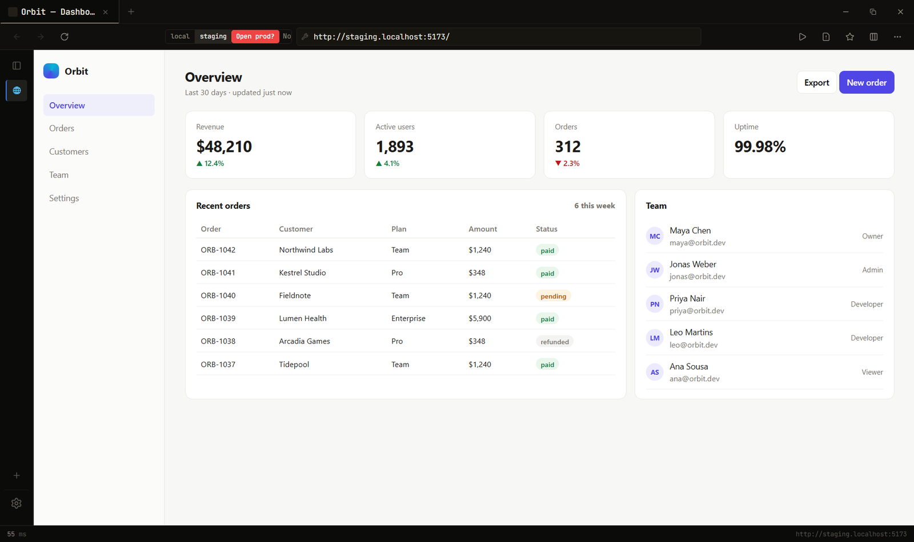

**Catch an error and hand it off.** A tab with JS errors or failed requests shows a count on the tab itself. Click it for the Console panel, then run **Copy Bug Report**: the URL, environment, device, browser and the recent errors and failed requests go to your clipboard as Markdown, and a screenshot of the page goes to Downloads. Paste it into the issue.

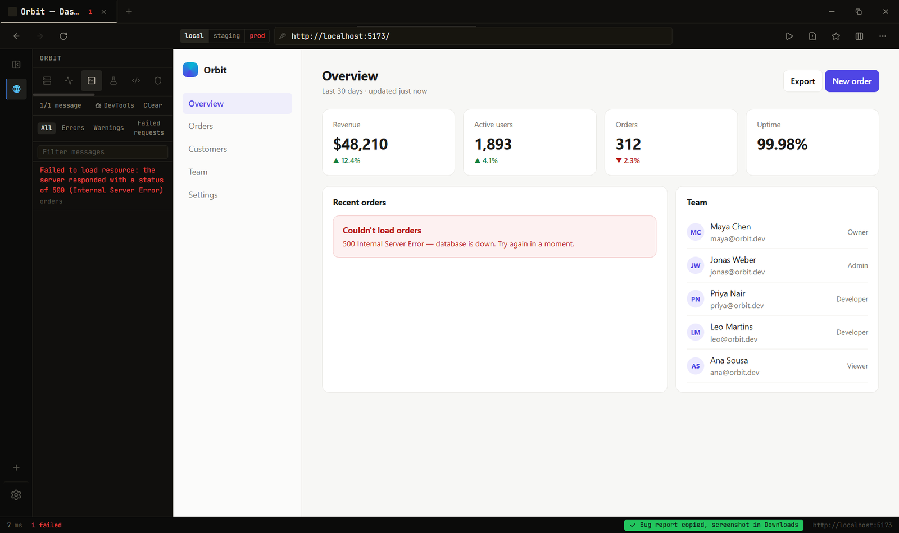

**Your own one-click actions.** Save a bit of JavaScript in **Settings → Snippets**, such as filling a test login, turning on a feature flag, or outlining every element to check the layout. It becomes a command like any other, so it can have its own shortcut or a toolbar button.

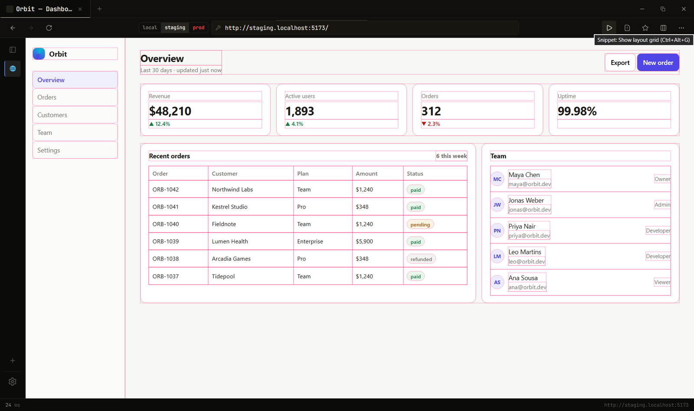

**The slow and broken network.** **Throttle Network: Slow 3G**, **Fast 3G** or **Offline** applies to the current tab and survives reloads, so you can see your loading and offline states. **Clear Site Data and Reload** wipes the site's cookies and storage for a first-visit test.

## Who it's for

Frontend and full-stack developers who spend the day on `localhost`. ZYNLEX is meant to be the browser you keep open next to your editor while you build: open your app, watch its requests, fake the API responses you can't easily reproduce (a 500, an empty list, a slow endpoint), check it on a phone-sized viewport, and move on.

It's a normal browser too — you can browse in it — but it isn't trying to replace Chrome or Firefox as your everyday browser.

## How it compares

| If you use… | For… | ZYNLEX |
|---|---|---|
| Chrome DevTools | Network tab, device mode | Same data, kept in the sidebar per tab, alongside the tools below |
| Charles / Proxyman / Requestly | Mocking and rewriting responses | Built in, no proxy or root certificate. Covers the page's own requests, not other apps |
| Postman / Insomnia | Sending API requests | A lighter API client with collections and cURL import, saved per workspace |
| Polypane / Responsively | Multi-device testing | One device at a time at real size. Use those if you need many side by side or accessibility audits |

## Why it exists

Two months ago I was watching [a video by @crynta](https://youtu.be/kykgXa7sm1g) and got stuck on a comment thread underneath it, where people were asking for a lightweight, telemetry-free browser. I wanted one too. But the version I actually needed was for development work, so that's the one I built.

Chrome DevTools is good and lives in the wrong place. It is a drawer inside a browser that has no idea what you're working on. Responsively and Polypane lead with device frames and aren't browsers you'd actually browse in. So the four things I check constantly (which port is that, what did that request return, how does this look on a phone, what happens with this header) lived in four separate windows.

ZYNLEX puts them in the browser chrome instead.

## Size and memory

### Compared with Chrome

Release builds on one Windows 11 machine. Clean profiles, identical pages, same 1280×800 window, 30 seconds after the pages load, median of 3 runs. Memory is summed over the app and every browser process it starts:

| | ZYNLEX 0.14 | Chrome | |
|---|---|---|---|
| Idle, one blank tab | **152 MB** | 348 MB | **56% less** |
| Three tabs (GitHub, YouTube, localhost) | **546 MB** | 692 MB | **21% less** |

That's committed (private) memory, the RAM a process has actually claimed. Working set, what's resident right now, shows the same picture: 410 vs 703 MB idle, 946 vs 1160 MB with three tabs.

### Where the memory goes, and what ZYNLEX does about it

Your tabs run on WebView2, which is Chromium, the same engine Chrome uses, so a heavy page costs about the same in both. The ZYNLEX app itself is about 10 MB. Everything else is WebView2's processes: one that coordinates, one per site, and helpers for networking and storage. ZYNLEX saves memory in four ways:

1. **It runs less.** No sync, no Safe Browsing, no prerendering, no extension host, no update service.
2. **Graphics run in the main browser process.** Chromium normally keeps a separate GPU process, and most of its 140–290 MB is fixed overhead. Moving it in saves 100–200 MB in every scenario, including an empty window.
3. **Hidden tabs are suspended** after 5 minutes. A suspended tab's scripts stop, and Windows pages its memory out of RAM. With 10 tabs open, resident memory drops by about 60%. Click the tab and it picks up where it was.
4. **Hidden tabs are discarded** after 10 minutes. The page is closed and reloads when you click it, with scroll position and form fields restored.

Before and after this work, on the same machine (ZYNLEX 0.13 → 0.14, private memory):

| | 0.13 | 0.14 | 0.14, hidden tabs suspended | 0.14 + low-memory process model |
|---|---|---|---|---|
| One blank tab | 267 MB | **152 MB** (−43%) | 170 MB | 167 MB |
| Three tabs | 758 MB | **546 MB** (−28%) | 496 MB (−35%) | 418 MB (−45%) |
| Ten tabs | 1577 MB | **1341 MB** (−15%) | 1277 MB (−19%) | **776 MB** (−51%) |

### Memory settings

All in **Settings → Memory**:

| Setting | Default | Trade-off |
|---|---|---|
| Suspend hidden tabs | After 5 min | A suspended tab stops updating (chat, dashboards, live logs) until you switch back. `localhost` tabs and tabs playing audio are never suspended. |
| Discard hidden tabs | After 10 min | The page reloads when you return to it. In-page state that isn't in a form field or the URL is lost. |
| GPU in main process | On | If your graphics driver crashes, the whole app closes instead of Chromium quietly restarting its GPU process. Turn it off if that happens to you. |
| Low-memory process model | Off | Turns off site isolation and shares two processes across all tabs: up to half the memory with many tabs open. Sites are less protected from each other (Spectre-class attacks), and one heavy tab can slow the rest. Fine for local development; leave it off for banking and similar. |

The last two take effect after a restart; the panel has a button for it.

The installer is 3.6 MB because WebView2 already ships with Windows, so there's no bundled copy of Chromium to download. That's also why there's no macOS or Linux build yet.

If you need macOS, several viewports side by side, or accessibility audits, [Responsively](https://responsively.app) and [Polypane](https://polypane.app) do those and ZYNLEX doesn't.

## Install

Download the installer from the [latest release](https://github.com/webtools-dotcom/Zynlex/releases/latest) and run it.

Windows 10 or 11. You need the WebView2 runtime, which is already on Windows 11 and most Windows 10 machines; the installer adds it if it's missing.

From source:

```bash
pnpm install
pnpm tauri dev
```

## A look around

Your servers, on the new tab page:

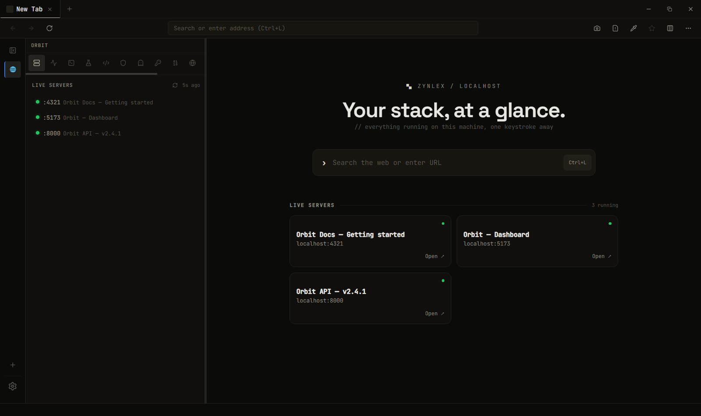

Network log. Capture goes through WebView2's native COM API, not a proxy, so there's nothing to configure and no certificate to trust.

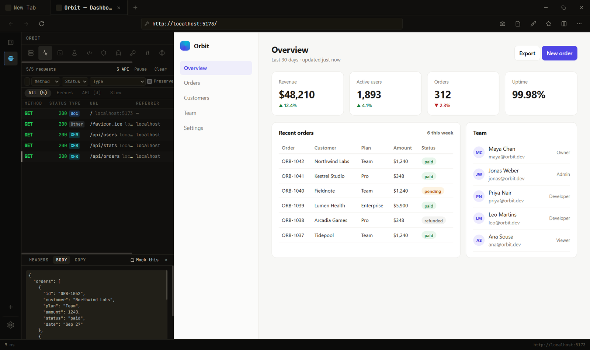

Mock responses. Click "Mock this" on a request, make it a 500, and see how the page handles it:

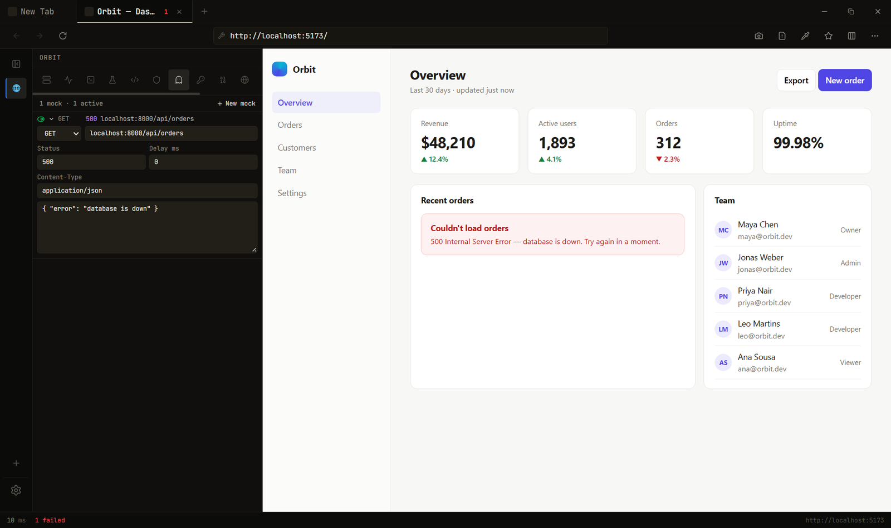

A device viewport at 1:1, next to the chrome:

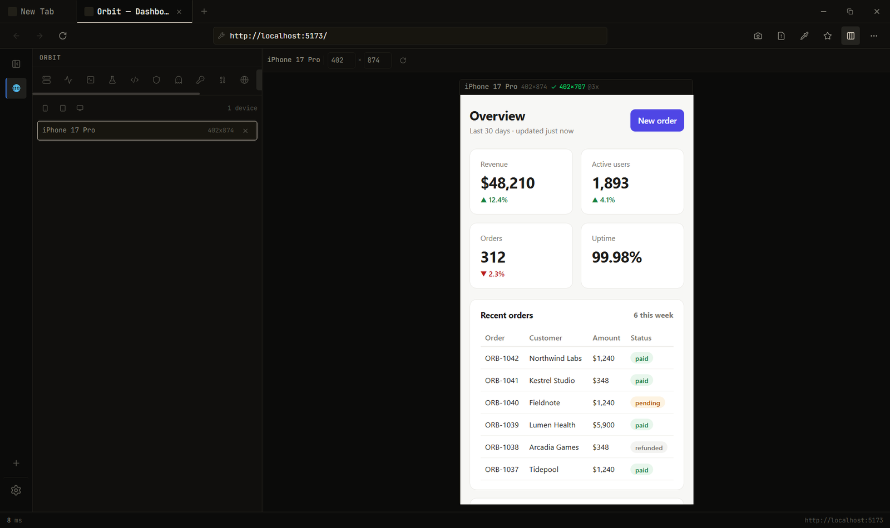

API client, saved per workspace:

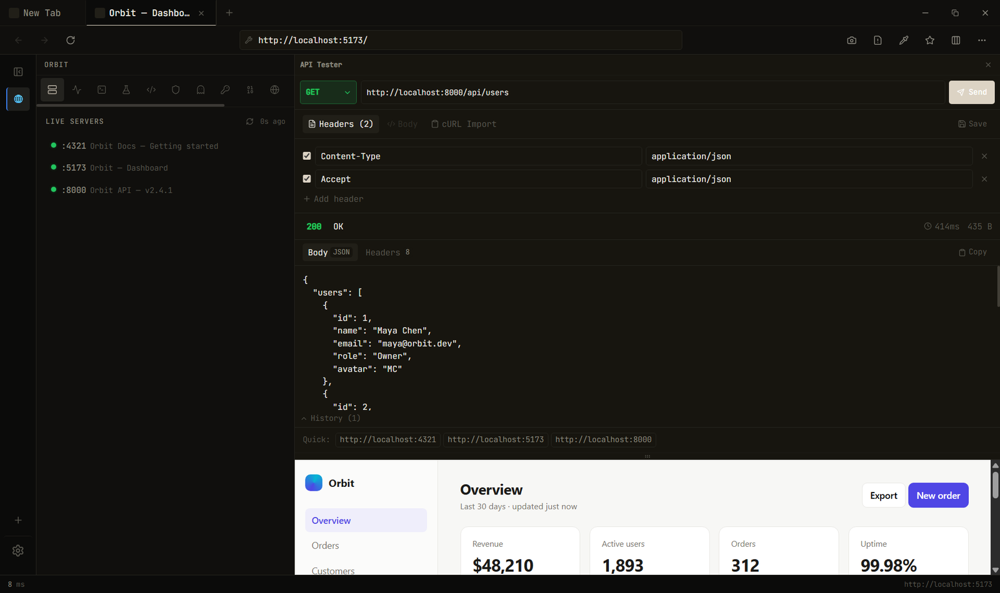

## Limitations

Worth knowing before you download:

- **Windows only.** Tabs, cookies, network capture, header injection and viewport emulation are written against WebView2 COM APIs. There's no WebKit equivalent yet, so there is no macOS or Linux build. macOS and Linux are planned, see [ROADMAP.md](ROADMAP.md).
- Downloads show started and finished, not a percentage. Tauri's download event has no progress callback.
- Header rules don't apply to WebSocket handshakes. WebView2 never raises its request event for them.
- The network log records every request type, but only keeps response bodies for text resources. Images, fonts and media show status, size and timing only. Use the type filter or the API chip to cut the asset noise.
- JWT signatures are decoded, never verified.

## FAQ

**Is ZYNLEX a minimal browser I can use every day?**
You can browse in it like any browser, and it is minimal: no sync, no extensions, no account. But it's built around development work, so it isn't trying to be your only browser. Most people keep it open next to their editor.

**Will websites work in it?**
Yes. Tabs render with WebView2, which is Microsoft's packaging of Chromium, the same engine as Chrome and Edge. Pages look and behave the same.

**How is it different from Chrome DevTools?**
DevTools is a drawer inside a general browser. ZYNLEX puts the network log, device viewports and header rules in the browser's own sidebar, per tab and per project workspace, and adds things DevTools doesn't have: localhost server detection, response mocking without a proxy, and an API client.

**Do I need a proxy or a certificate to mock API responses?**
No. Mocks are answered inside the browser, before the request reaches the network, so there's nothing to install or trust. Cross-origin requests work too. The trade-off: it only mocks requests made by pages open in ZYNLEX, not other apps on your machine.

**Why is it so small? Is it Electron?**
It's not Electron. It's built with Tauri and Rust, and uses the WebView2 runtime that already ships with Windows instead of bundling its own copy of Chromium. That's why the installer is 3.6 MB.

**Why does it use less RAM than Chrome if it's the same engine?**
It runs fewer background services, keeps graphics in one process instead of two, and suspends and discards tabs you aren't looking at. See [Size and memory](#size-and-memory) for the numbers and the trade-offs.

**Why did a background tab reload, or show old data when I came back?**
Hidden tabs are suspended after 5 minutes and discarded after 10, to keep memory down. A suspended tab catches up when you switch back to it; a discarded one reloads. Change either timer, or turn them off, in Settings → Memory. Pinned tabs and `localhost` tabs are never suspended.

**Does it work on macOS or Linux?**
Not yet. Every developer feature is built on WebView2 APIs that only exist on Windows. See [ROADMAP.md](ROADMAP.md).

**Is it free? Does it collect any data?**
Free and open source under Apache-2.0. No account, no telemetry, and it makes no network calls of its own apart from checking GitHub for updates.

## Docs

- [docs/architecture.md](docs/architecture.md): process model, bounds and resize, viewport emulation, security boundary
- [docs/design-system.md](docs/design-system.md): tokens, typography, layout rules
- [CONTRIBUTING.md](CONTRIBUTING.md): build commands and the checks CI runs
- [ROADMAP.md](ROADMAP.md): what's open

## Contributing

If ZYNLEX saves you a window or two, a star helps other developers find it.

Issues and pull requests welcome. If you're picking up something non-trivial, open an issue first so we don't both write it.

Built with [Tauri](https://tauri.app), React and Rust.

## License

[Apache-2.0](LICENSE)
