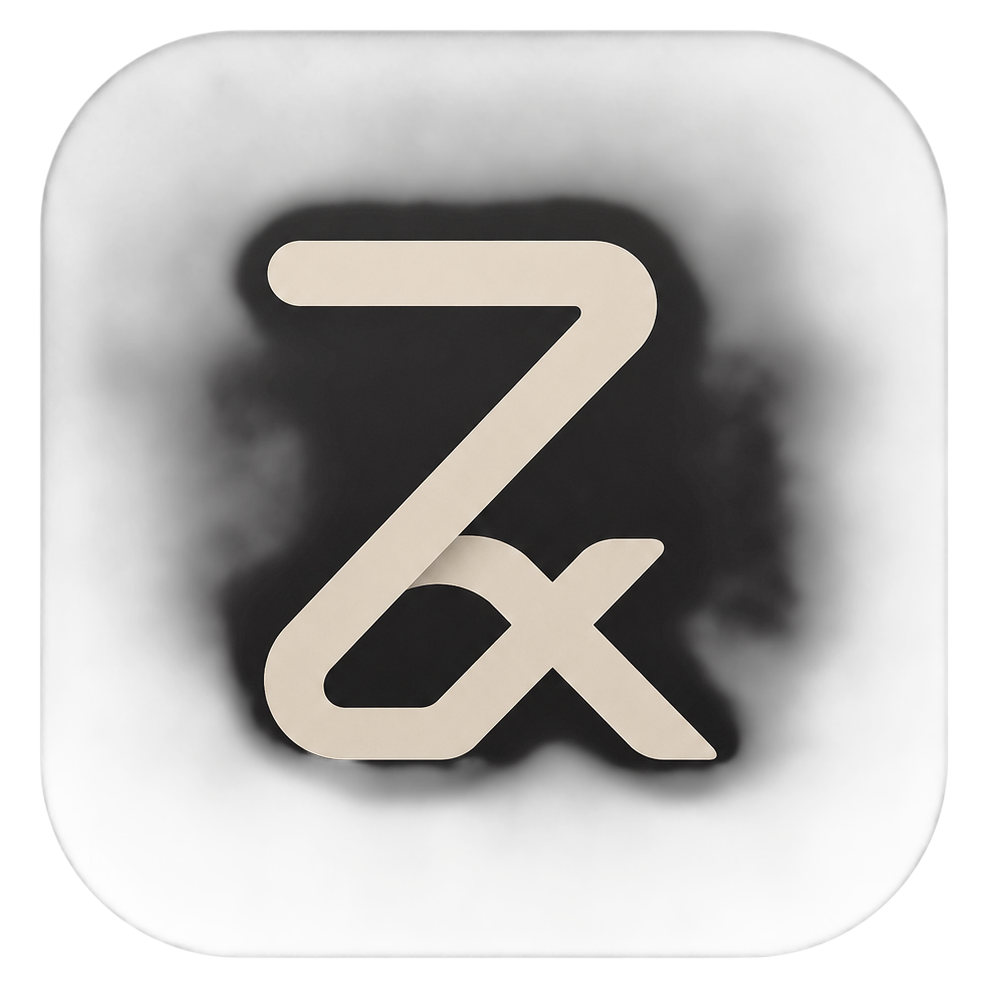
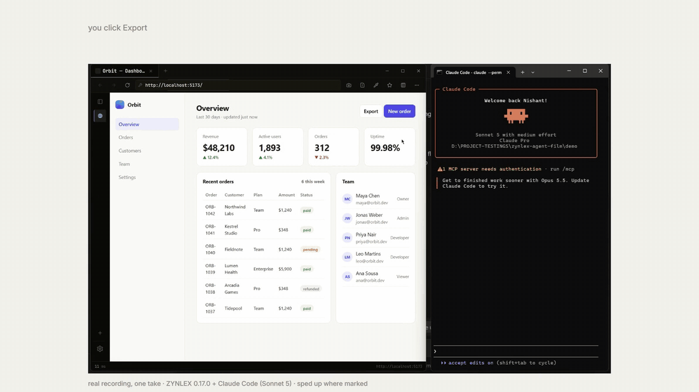
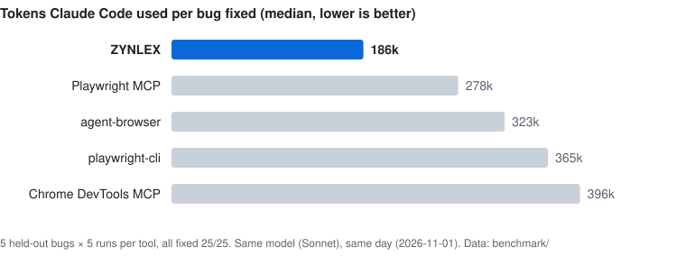
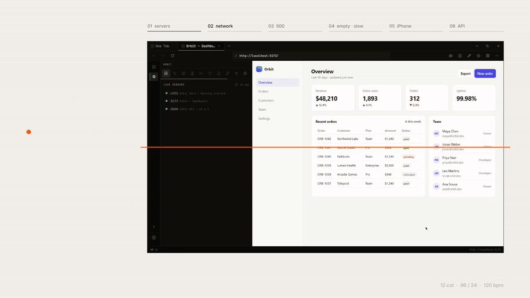
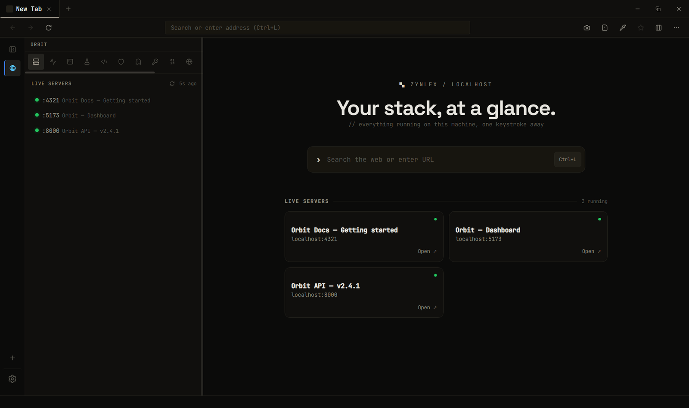
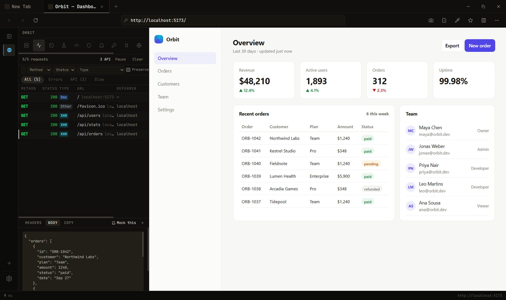
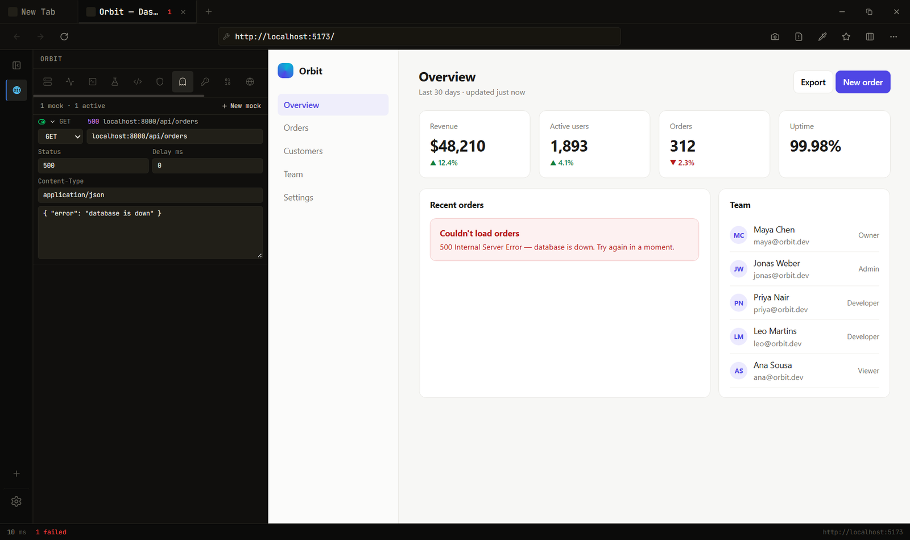
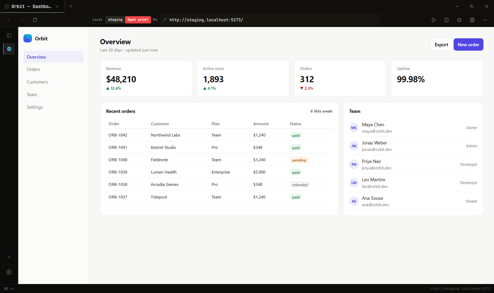
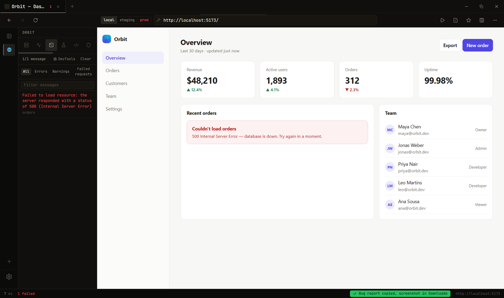
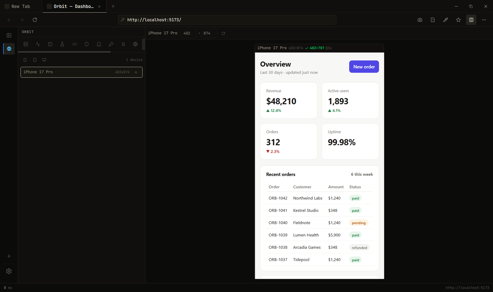

<div align="center">



# ZYNLEX

**The browser you share with your AI coding agent.**

Claude Code, Codex and other coding agents test your `localhost` app in the ZYNLEX window you already have open.<br>
You watch every click, point at what's broken, and take over whenever you want.<br>
It costs the agent less than Playwright MCP, and it's a developer's browser in its own right.

[](https://github.com/webtools-dotcom/Zynlex/releases/latest)
[](https://github.com/webtools-dotcom/Zynlex/actions/workflows/ci.yml)
[](LICENSE)
[](https://github.com/webtools-dotcom/Zynlex/releases/latest)

<a href="https://webtools-dotcom.github.io/Zynlex/assets/zynlex-shared.mp4"></a>

<sub>One real take with Claude Code, sped up where marked · [Watch the 52-second film with sound](https://webtools-dotcom.github.io/Zynlex/assets/zynlex-shared.mp4)</sub>

### [Download for Windows →](https://github.com/webtools-dotcom/Zynlex/releases/latest)

then, in a new terminal:

```bash
claude mcp add zynlex zynlex-mcp
```



<sub>[How this was measured, with every run's data](benchmark/README.md)</sub>

</div>

---

## Your agent tests in a browser you can't see

Ask a coding agent to check your app today and it launches a browser of its own: a fresh profile, not logged in, empty console, somewhere off screen. It doesn't know about the error you hit five minutes ago. You can't point at the button that's wrong; you describe it in words and hope. It clicks around, finds the bug again from scratch, and hands you a summary of what it did.

ZYNLEX turns that around. The agent works in **your** browser, on the tab in front of you. You both see the same page at the same time.

## What that changes

**You point instead of describing.** Press `Ctrl+Shift+E`, click the broken element, type a note. The agent's next reply starts with it, and with the element's ref so it can act on it straight away:

```
Developer flagged e15 button "Apply": does nothing on mobile
```

**You show it the bug instead of writing steps.** Start **Record Steps for Agent**, reproduce the bug the way you found it, stop. The agent reads every click and key, and the error or failed request each one caused:

```
2. press Enter in textbox "New task" [e2] → ReferenceError: addTsk is not defined
5. click button "Load tasks" [e8] → GET /api/tasks 404
```

**It already knows what broke.** ZYNLEX records errors and failed requests the whole time you use it. When an agent connects, its first look at a tab starts with what happened **before it arrived**, grouped and counted, so it doesn't have to reproduce what you already saw.

**You can watch it, stop it, or take over.** Every action happens in the visible page, and the **Agent Activity** panel lists each call. **Pause** in the status bar holds the agent while you use the page yourself; on **Resume** it's told what changed. **Stop** disconnects it.

**The fix stays fixed.** Once the bug is fixed, the agent turns your recording into a Playwright test, with your mocks, so it runs in CI from then on. ZYNLEX finds the bug; Playwright keeps it from coming back.

**It's already logged in, because you are.** No test accounts, no saved cookies, no passwords in a prompt. The agent uses the session you have open.

## Cheaper, too

Each action already returns what changed on the page and any new errors, so the agent rarely needs a second look. Steps it already knows (type, then press Enter; click Delete, then accept the confirm) go in a single call. Claude Code re-sends its whole context on every turn, so fewer turns means fewer tokens.

The latest run on the same day as Playwright MCP: Claude Code fixing five bugs it had never seen, five runs each.

| | ZYNLEX | Playwright MCP |
|---|---|---|
| Bugs fixed | 25/25 | 25/25 |
| Tokens per bug (median) | **173k** | 240k |
| Cost per bug (median) | **$0.119** | $0.187 |
| Turns per bug (median) | **10** | 12 |

That's 28% fewer tokens and 36% lower cost. It's our own harness, on one machine, with one model family, which is why the harness, the buggy apps, the graders and every run's result are in [benchmark/](benchmark/README.md) for you to rerun.

## What a session looks like

Real replies from the v0.17.0 release, word for word. The agent calls `open` with `http://localhost:7720/`:

```
http://localhost:7720/ "Tasks" [dfc7d5cc]
Page:
h1 "Tasks"
textbox "New task" [e2] value=""
button "Add" [e6]
combobox "Sort" [e3] value="Oldest" collapsed
  option "Oldest" [e22] selected
  option "Newest" [e25]
button "Load tasks" [e8]
No new errors or failed requests.
```

Then one `act` with two steps, typing into `e2` and pressing Enter in it:

```
Typed "Release check" into textbox "New task" [e2] value=""
Pressed Enter in textbox "New task" [e2] value=""
Page changes:
+ "Release check"
No new errors or failed requests.
```

After each code change the agent calls `check`, which waits for the page to settle and lists only what's new.

## ZYNLEX or Playwright MCP?

Both, for different jobs. Keep Playwright for CI.

| | ZYNLEX | Playwright MCP |
|---|---|---|
| Where the agent works | Your open browser, in front of you | A browser it launches, or your Chrome through an extension |
| Point at an element, record a bug, pause and take over | ✅ in the page you're using | Partly: annotate and record, in its own dashboard |
| Errors from before the agent connected | ✅ kept across page loads | From when it connects |
| Logged in as you | ✅ | With the extension; otherwise saved state or a login flow |
| Mocks you can also see and edit in the UI | ✅ | ❌ |
| Turns a recording into a Playwright test | ✅ | ✅ (codegen) |
| Any website | ❌ `localhost` and staging you allow | ✅ |
| Headless, CI, Firefox, WebKit | ❌ | ✅ |
| macOS and Linux | ❌ Windows only, for now | ✅ |

## Set up

1. [Download the installer](https://github.com/webtools-dotcom/Zynlex/releases/latest) and run it. It puts `zynlex-mcp` on your PATH.
2. In a new terminal, connect your agent:

   ```bash
   claude mcp add zynlex zynlex-mcp
   ```

   **Settings → AI agents** has the snippet for Codex, Cursor, Antigravity, OpenCode and any other MCP client.
3. Open your app in ZYNLEX and ask your agent to check it: *"The Add button does nothing when I press Enter. Fix it."*

### What the agent can do

| Tool | What it does |
|---|---|
| `tabs`, `open` | List your tabs and running dev servers; open or switch to one |
| `snapshot` | The page's interactive elements, with refs to act on |
| `act` | Click, type, select, press, hover, drag, upload, go back, answer dialogs; up to 10 steps in one call |
| `check` | Wait for the page to settle, then list new errors and failed requests |
| `errors`, `network` | The console at any level; requests with headers and bodies |
| `screenshot` | The view, one element or the whole page |
| `viewport` | Emulate a phone or tablet, with touch |
| `wait_for` | Wait for text to appear or go, or the URL to change |
| `mock` | Fake API responses or add request headers, shown in your panels too |
| `eval` | Run JavaScript in the page |
| `recording` | Your recorded steps, or a Playwright test made from them |

### What it can reach

`localhost`, plus any staging environment you tick **agent** on in **Settings → Environments**. Never production, even if you tick it. Page text, console messages and response bodies are passed to the agent as data, not instructions. The status bar shows when an agent is connected. Every detail is in [docs/agent-interface.md](docs/agent-interface.md).

## It's a developer's browser first

Before agents could use it, ZYNLEX was the browser for `localhost`, and it still is. A new tab lists the dev servers running on your machine. The sidebar has what you'd otherwise open four apps for, and an agent can use all of it too.

<a href="https://webtools-dotcom.github.io/Zynlex/assets/zynlex-tour.mp4"></a>

<sub>[Watch the full tour in 1080p](https://webtools-dotcom.github.io/Zynlex/assets/zynlex-tour.mp4) · [Watch the workflows film (73 s)](https://webtools-dotcom.github.io/Zynlex/assets/zynlex-one-key.mp4) · [Website](https://webtools-dotcom.github.io/Zynlex/)</sub>

- **Network log**: per tab, with filters, search and response bodies. No proxy, no certificate.
- **Mock responses**: make any API return a 500, an empty list or a slow reply, by URL pattern, or click **Mock this** on a captured request.
- **Console**: each tab's errors and failed requests, with a count on the tab itself so you notice.
- **Device viewports**: one device at a time, at its real pixel size.
- **Header rules**: add, override or strip request headers per URL pattern.
- **API client**: saved collections and cURL import, sent from Rust so page CORS doesn't apply.
- **Environments**: the same path on local, staging and production in one click. Production is marked red and asks first.
- **Copy Bug Report**: URL, environment, device, recent errors and a screenshot, ready to paste into an issue.
- **Snippets**, **network throttling**, **full-page screenshots**, a **colour picker**, and a JWT decoder, Base64 and user-agent switcher.

Workspaces keep each project's tabs, rules and saved requests apart, `Ctrl+K` finds everything, and any command can have a shortcut or a toolbar button.

It's light: a 4 MB installer because it uses the WebView2 (Chromium) runtime already in Windows, and less than half Chrome's memory at idle. Hidden tabs are suspended and then discarded on timers you set, and `localhost` tabs never are, so hot reload keeps working. [The measurements](docs/performance.md).

No account, no telemetry. The only network call it makes on its own is an update check against this repo's releases.

<details>
<summary><b>Screenshots</b></summary>

Your servers, on the new tab page:



Network log, with a response open:



A mocked 500, and how the page handles it:



The same page on local, staging and prod:



A bug report, one click:



A device viewport at 1:1:



</details>

## Why I built it

A few months ago I was watching [a video by @crynta](https://youtu.be/kykgXa7sm1g) and got stuck on the comments underneath, where people were asking for a lightweight browser without telemetry. I wanted one too, but the one I needed was for development: the four things I check constantly (which port is that, what did that request return, how does this look on a phone, what happens with this header) lived in four separate windows. So I put them in the browser.

Then I started handing more of the checking to coding agents, and watched them work in a browser I couldn't see. They'd launch a clean Chrome, miss the error I'd just been looking at, and spend half the run getting back to where I already was. Meanwhile my own browser had already captured all of it: every error, every request, the page I was pointing at.

So ZYNLEX gave the agent a way in, to the browser I'm already using, with me able to see every step.

## Limitations

- **Windows only.** Tabs, network capture, mocking and viewports are built on WebView2's Windows APIs. macOS and Linux are on the [roadmap](ROADMAP.md), and they're a real port, not a recompile.
- **Agents reach `localhost` and staging you allow, nothing else.** For other sites, use Playwright.
- **Not signed yet.** Windows shows "Unknown publisher" and some antivirus software quarantines new builds until signing is approved ([policy](CODE_SIGNING_POLICY.md)).
- The benchmark is one machine and one model family, on small apps written for it. The data is there so you can check it.
- Header rules don't apply to WebSocket handshakes; the network log keeps bodies only for text responses; downloads show no progress percentage.

## FAQ

**Should I uninstall Playwright?**
No. Keep it for CI, headless runs and other browsers. ZYNLEX is for the loop where you and an agent build and fix your app together; the tests it writes run on Playwright.

**Which agents work with it?**
Any MCP client. **Settings → AI agents** has setup for Claude Code, Codex, Cursor, Antigravity and OpenCode. The benchmark uses Claude Code.

**Can the agent see my other tabs, or my banking site?**
No. It only sees `localhost` tabs and staging environments you've ticked **agent** on. Production is refused even if ticked.

**Will websites work in it?**
Yes. Tabs render with WebView2, Microsoft's packaging of Chromium, the same engine as Chrome and Edge.

**Is it Electron?**
No. It's Tauri and Rust on the WebView2 runtime that ships with Windows, which is why the installer is 4 MB.

**Is it free?**
Free and open source under Apache-2.0. No account, no telemetry.

## Docs

- [docs/agent-interface.md](docs/agent-interface.md): the MCP server, every agent tool, the safety model
- [benchmark/README.md](benchmark/README.md): the agent benchmark, its data and harness
- [docs/performance.md](docs/performance.md): memory compared with Chrome, and the settings that trade it off
- [docs/architecture.md](docs/architecture.md): process model, network capture, security boundary
- [CONTRIBUTING.md](CONTRIBUTING.md) · [ROADMAP.md](ROADMAP.md) · [CHANGELOG.md](CHANGELOG.md)
- [CODE_SIGNING_POLICY.md](CODE_SIGNING_POLICY.md): how releases are signed. Free code signing provided by [SignPath.io](https://about.signpath.io/), certificate by [SignPath Foundation](https://signpath.org/)

## Contributing

If ZYNLEX saves your agent tokens, or you a few windows, a star helps other developers find it.

Issues and pull requests are welcome. For anything non-trivial, open an issue first so we don't both write it. From source: `pnpm install`, then `pnpm tauri dev`.

## License

[Apache-2.0](LICENSE)
